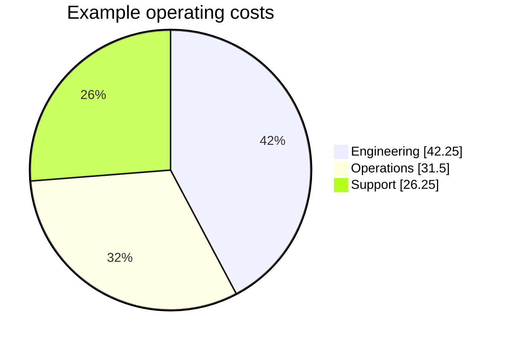

# Native Mermaid diagrams

Mermaid fences use the same first-party SVG compiler in HTML, PDF, SVG posters,
and EPUB. Rendering does not load Mermaid.js, execute scripts, or contact the
network. Flowcharts (`graph`/`flowchart`), sequence diagrams (`sequenceDiagram`),
and pie charts are supported. Other diagram types retain their source as a
highlighted code block.

## Pie charts

````markdown

````

The `pie` header is required. `showData` is optional and adds the original values
to the legend. An optional `title` may appear on the header or on its own line
before the data. Each data line contains a unique, nonempty double-quoted label,
a colon, and a positive decimal value with at most two decimal places. Slices
follow source order clockwise from the top. `%%` introduces a comment outside
quoted labels; the same characters inside a label remain text.

Values and totals use integer hundredths. Displayed percentages are rounded to
one decimal place, while the accessible SVG description retains every original
value. Labels and titles are escaped and wrapped; single-slice charts render a
complete circle. PDF uses native vector paths and figure tags, and EPUB declares
its inline SVG in the publication manifest.

Admission is bounded to 64 KiB of diagram source, 64 slices, 512 UTF-8 bytes per
label, and 1024 bytes of title. Each value must fit an unsigned 64-bit integer
after multiplication by 100. Invalid numbers, duplicate labels, extra directives,
or exceeded limits preserve the **entire source block** instead of drawing a
partial or misleading chart. Frontmatter configuration and Mermaid initialization
directives, including donut and legend-position customization, are not supported
and likewise retain source. The renderer-neutral interactive Flow display bridge
retains its existing, separate diagram capabilities.

The supported pie grammar follows the [official Mermaid pie syntax](https://mermaid.js.org/syntax/pie.html).
See [the example document](../examples/pie-charts.md) for ready-to-render input.
