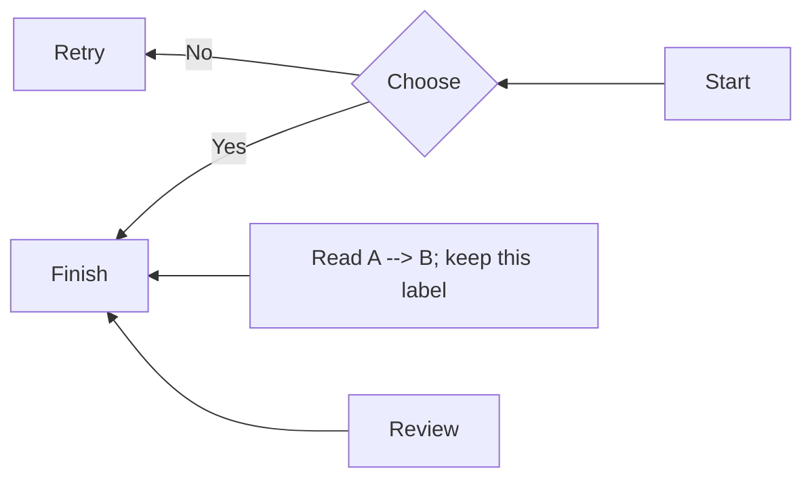
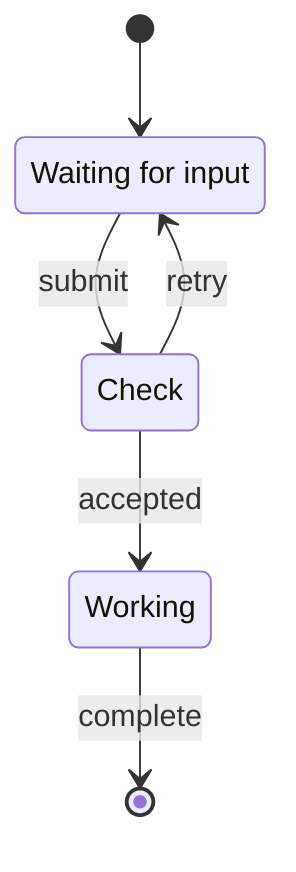
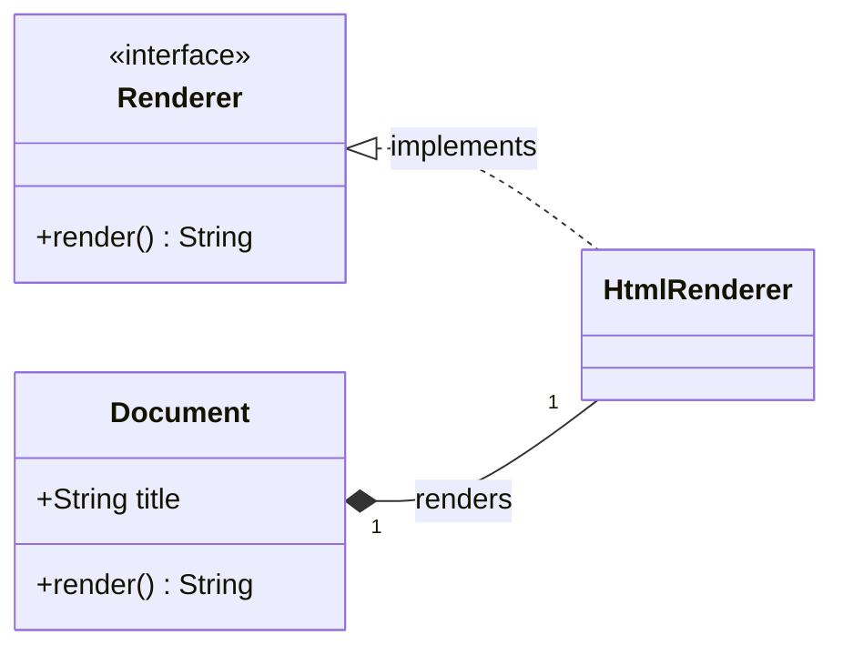
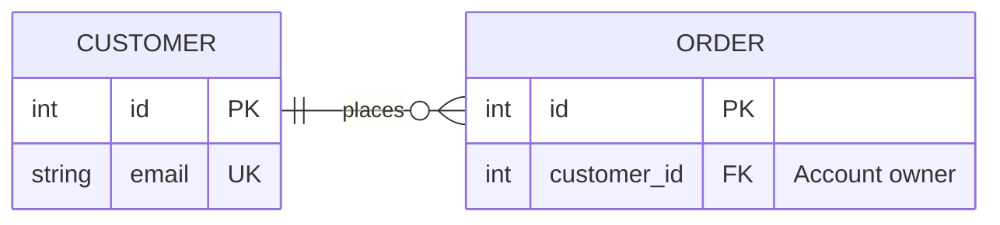
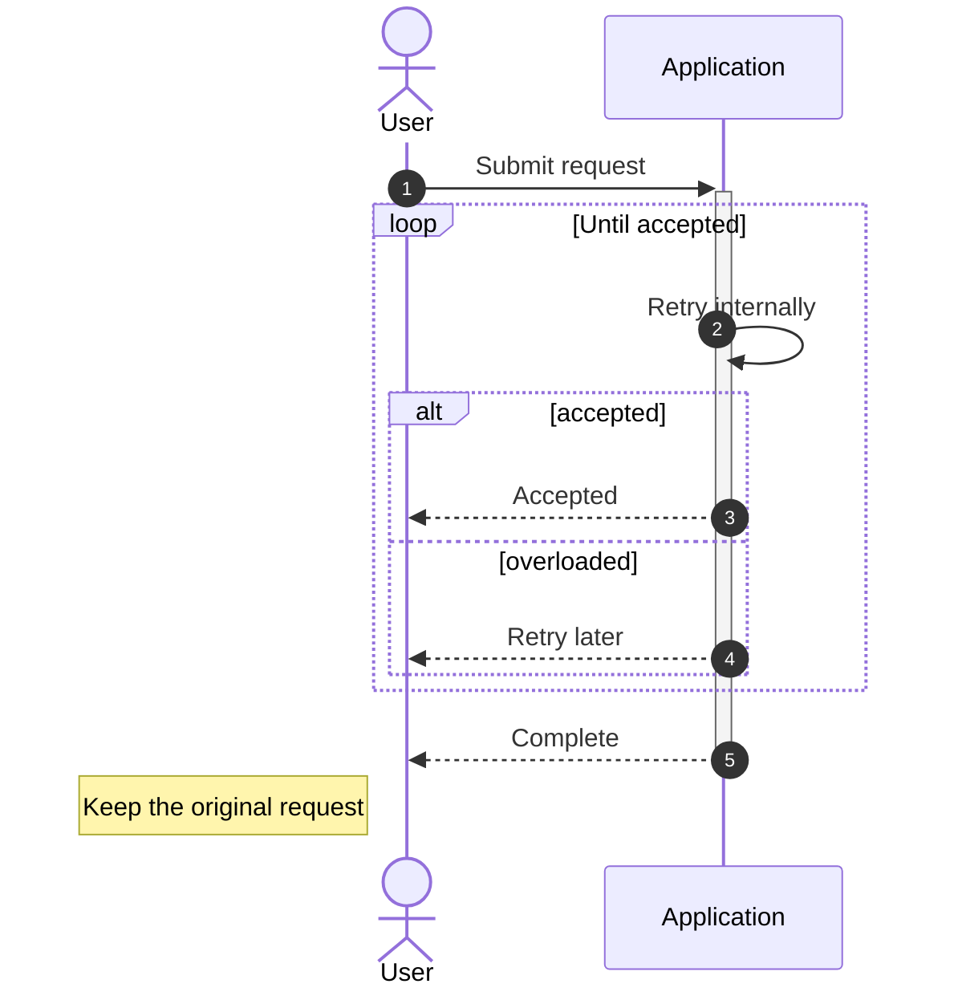
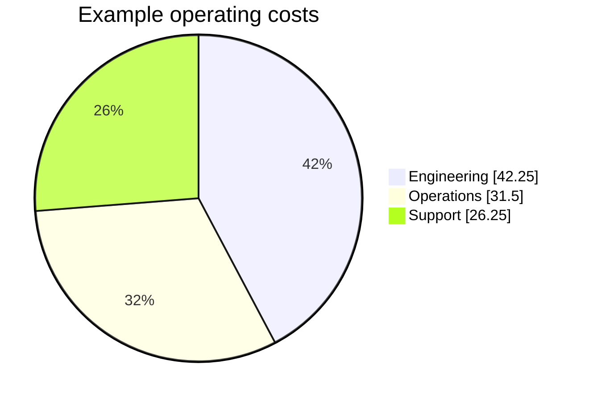

# Native Mermaid diagrams

Mermaid fences use the same first-party SVG compiler in HTML, PDF, SVG posters,
and EPUB. Rendering does not load Mermaid.js, execute scripts, or contact the
network. Flowcharts (`graph`/`flowchart`), state diagrams
(`stateDiagram`/`stateDiagram-v2`), class diagrams (`classDiagram`), entity-relationship
diagrams (`erDiagram`), sequence diagrams (`sequenceDiagram`), and pie charts are supported. Other diagram types retain their source as a
highlighted code block.

## Flowcharts

````markdown

````

Flowcharts accept `graph` or `flowchart`, with `TD`/`TB`, `BT`, `LR`, or `RL`
direction. A bare header defaults to top-to-bottom. A fence explicitly named
`flowchart` can omit the header. Newlines and semicolons separate statements;
quoted labels own their arrows, brackets, semicolons, and `%%` characters.
Outside labels, `%%` starts a line comment.

Nodes can be rectangles (`A[Text]`), rounded rectangles (`A(Text)`), stadiums
(`A([Text])`), diamonds (`A{Text}`), or circles (`A((Text))`). Identifiers use
letters, digits, `_`, `.`, and single hyphens; quote labels containing syntax
characters. A later explicit node declaration updates its label and shape,
while a bare reference keeps the existing declaration. Circle bounds include
the full label.

Supported links include solid arrows (`-->`), open lines (`---`), dotted arrows
(`-.->`) and lines (`-.-`), and thick arrows (`==>`) and lines (`===`). Text can
follow a link in pipes (`-->|Yes|`) or occur inside it (`-- Yes -->`,
`-. Yes .->`, `== Yes ==>`). Quotes also protect syntax within edge labels.
Chains retain each intermediate node; `A & B --> C & D` creates all four
connections. Acyclic joins are placed after every predecessor, and `RL`/`BT`
reverse both node positions and edge direction.

Self-loops (`A --> A`), feedback connections and connections that skip layers
use separate lanes outside the node area. Their arrows approach the destination from
its normal incoming side, and dotted, thick, open, and labeled links keep their
meaning. Return labels have their own space, and the SVG canvas expands to keep
the routes and labels visible in every direction. Horizontal layer spacing
reserves caption widths. Parallel transitions and conflicting captions also
receive separate lanes, so one transition's label cannot hide another.

Admission is bounded to 64 KiB of source, 256 nodes, 1024 expanded edges,
128 UTF-8 bytes per identifier, and 512 bytes per label. Malformed statements,
exceeded limits, and unsupported constructs retain the **entire source block**.
This includes subgraphs, style/class/click directives, Mermaid configuration,
extended shapes, and edge metadata. Labels are single-line plain text, escaped
for SVG. No part of an unsupported graph is silently discarded or replaced
with an invented node.

The supported grammar follows the [official Mermaid flowchart syntax](https://mermaid.js.org/syntax/flowchart.html).
See [the flowchart example](../examples/flowcharts.md) for chains, grouped links,
quoted labels, and reverse directions.

## State diagrams

````markdown

````

Flat state machines accept the `stateDiagram` and `stateDiagram-v2` headers.
The header is required, including in a fence explicitly named `state`.
States can be introduced by transitions, declared by identifier, or given a
description with `state "Description" as Identifier` or
`Identifier: Description`. A description may follow the first use of its
state; it replaces the implicit identifier label.

Transitions use `-->` and an optional colon followed by their guard or event.
`[*]` on the left creates an initial filled circle; on the right it creates
a separate final double-circle marker. Named `<<choice>>` states draw diamonds,
and `<<fork>>`/`<<join>>` states draw bars perpendicular to the direction of
travel. A single `direction TD`, `TB`, `BT`, `LR`, or `RL` statement selects
the layout. Self-transitions, feedback, parallel transitions and branches
retain distinct connections and nonoverlapping captions.

Newlines separate statements. `%%` introduces a trailing or standalone comment,
while a quoted state description owns literal `%%` characters. Descriptions
and transition labels are single-line plain text escaped for SVG. A colon or
arrow within a transition label remains text. The same SVG scene reaches
HTML, tagged PDF, SVG posters, single-document and book EPUB, and browser
Flow's native vector paths and accessible source transcript.

Admission is bounded to 64 KiB of source, 256 states including initial/final
markers, 1024 transitions, 128 UTF-8 bytes per identifier, and 512 bytes per
label. Composite states, notes, concurrent regions, repeated descriptions,
labels on pseudostates, classes/styles, accessibility directives, configuration,
and semicolon-separated statements are outside this subset. Unsupported or
malformed input preserves the **entire source block** without a partial diagram.

The supported grammar follows the
[official Mermaid state syntax](https://mermaid.js.org/syntax/stateDiagram.html).
See [the state-machine examples](../examples/state-diagrams.md).

## Class diagrams

````markdown

````

The `classDiagram` header is required, including in an explicitly named
`class` fence. Classes can be declared with `class Name`, introduced by a
relationship, given a display label with `class Name["Display label"]`, or
named with backticks. Members can be written in multiline braces or as
`Name : member`. Attributes and methods occupy separate compartments;
visibility prefixes and return types remain visible. Static members use drawn
underlines; abstract methods retain their `*` classifier. Stereotypes such as
`<<interface>>` appear above the class name.

Relationships retain their UML endpoints: open triangles for inheritance and
realization, filled diamonds for composition, open diamonds for aggregation,
and open arrows for association and dependency. Solid and dashed connectors,
bidirectional endpoint combinations, optional quoted multiplicities and colon
labels preserve their meaning. A single `direction TD`, `TB`, `BT`, `LR`,
or `RL` controls layout. Cycles, self-links and parallel relationships reuse
the native graph router's separate lanes.

Labels and members are escaped text. Newlines separate statements; standalone
`%%` comments are accepted. Source admission is bounded to 64 KiB, 256 classes,
1024 relationships, 128 UTF-8 bytes per identifier, 512 bytes per label or
member, 64 bytes per multiplicity, 64 members per class and 2048 members in total. Unsupported syntax or
exceeded limits preserve the **entire source block**. Namespaces, notes,
callbacks, custom styles, Mermaid configuration, generic type notation and
semicolon-separated statements are outside this profile.

The compiler feeds HTML, tagged PDF figures, SVG posters, EPUB chapters and
Flow's native vector scene. Flow retains the exact source as its accessible
transcript. The supported syntax is described by the
[official Mermaid class reference](https://mermaid.js.org/syntax/classDiagram.html).
See [the class diagram examples](../examples/class-diagrams.md).

## Entity-relationship diagrams

````markdown

````

The `erDiagram` header is required, including in an explicitly named `er` fence.
An entity can stand alone, begin an attribute block or first appear in a
relationship. Double quotes allow names containing spaces and punctuation;
`CUSTOMER["Customer account"]` assigns a display alias without changing the
entity's identity. A later attribute block extends the same entity in source
order.

Attribute rows contain a type and name, optional `PK`, `FK`, or `UK` keys
(comma-separated for combinations), and an optional quoted comment. A leading
`*` on the attribute name also marks a primary key. Nullable type suffixes,
array notation and numeric type parameters such as `decimal(10,2)` remain
visible. The renderer sizes separate type, name, key and comment columns,
wraps long cells, and preserves every row.

Relationships draw their actual crow-foot endpoints:

| Left marker | Right marker | Cardinality |
|---|---|---|
| `\|o` | `o\|` | Zero or one |
| `\|\|` | `\|\|` | Exactly one |
| `}o` | `o{` | Zero or more |
| `}\|` | `\|{` | One or more |

Use `--` for an identifying relationship and `..` for a non-identifying,
dashed relationship. Each relationship requires a colon and label; quote
multiword labels or punctuation. `direction TB`, `BT`, `LR`, and `RL`
select the layout. Self-links, parallel edges and cycles keep separate routes
and captions. Endpoint symbols are ordinary vector paths and circles, so the
publication and Flow renderers receive the same notation.

Newlines separate declarations and relationships. Attribute rows can share
a line inside braces. `%%` introduces comments outside quoted text; tabs in
display labels expand to four spaces. Admission is bounded to 64 KiB of
source, 256 entities, 1024 relationships, 128 attributes per entity and 2048
attributes total, 128 UTF-8 bytes per identifier and 512 bytes per label or
comment. Flow's existing scene budgets still apply to large admitted diagrams.

Labels are escaped plain text; Markdown inside them is not interpreted.
Word aliases for cardinalities, styles, classes, interactions, configuration
and semicolon-separated statements are outside this subset. Unsupported syntax, malformed rows and exceeded limits
retain the **entire source block**. All output remains offline and uses the
shared native compiler.

See the [official Mermaid ER syntax](https://mermaid.js.org/syntax/entityRelationshipDiagram.html)
and [the entity diagram examples](../examples/entity-relationships.md).

## Sequence diagrams

````markdown

````

Sequence diagrams retain participant order and explicit aliases, including a
declaration after a participant's first message. `actor` draws a person symbol.
The header is `sequenceDiagram`; an explicitly named `sequence` fence may omit
it. Newlines and semicolons separate statements, and `%%` introduces a comment
at the start of a statement. Initialization/configuration directives are not
treated as ordinary comments.

Messages distinguish solid and dotted lines (`->`, `-->`), filled arrows
(`->>`, `-->>`), open asynchronous arrows (`-)`, `--)`), crossed endpoints
(`-x`, `--x`), and bidirectional arrows (`<<->>`, `<<-->>`). Self-messages have
an outward and return path. `activate`/`deactivate` and the `+`/`-` message
suffixes draw stacked activation bars; `+` activates the recipient and `-`
deactivates the sender. An unmatched deactivation retains the whole source;
an activation left open extends to the bottom of its lifeline.

Nested `loop`, `alt`/`else`, `opt`, `par`/`and`, `critical`/`option`, and `break`
fragments draw explicit frames and branch separators, with every condition
visible. `Note left of`, `Note right of`, and `Note over` preserve their actual
placement; `over` can name one or two participants. Titles, `accTitle:` and
single-line `accDescr:` metadata are retained. `autonumber` starts at one, or
accepts an unsigned integer start and a positive integer increment.

Labels wrap within measured conservative boxes, participant columns make room
for message text, and the canvas includes side notes and self-messages.
`<br>`, `<br/>`, and `<br />` introduce label line breaks; other markup is
escaped. Decimal character references such as `#59;` (a literal semicolon) and
named references such as `#infin;` are decoded as text, never executable markup.

Admission is bounded to 64 KiB of source, 64 participants, 1024 events,
16 nested fragments, 32 stacked activations per participant, 128 UTF-8 bytes
per identifier, and 1024 bytes per source label. Unknown statements, malformed
branches, unsupported arrows, and exceeded bounds retain the **entire source
block**. Background `rect` blocks, participant `box` groups, participant JSON
configuration, creation/destruction, menus, central connections, half-arrows,
fractional numbering, and Mermaid initialization remain outside this subset.

The supported grammar follows the [official Mermaid sequence syntax](https://mermaid.js.org/syntax/sequenceDiagram.html).
See [the sequence example](../examples/sequence-diagrams.md) for complete
request/response, retry, and parallel-work examples.

## Pie charts

````markdown

````

The `pie` header is required. `showData` is optional and adds the original values
to the legend. An optional `title` may appear on the header or on its own line
before the data. Each data line contains a unique, nonempty double-quoted label,
a colon, and a positive decimal value with at most two decimal places. Slices
follow source order clockwise from the top. `%%` introduces a comment outside
quoted labels; the same characters inside a label remain text.

Values and totals use integer hundredths. Displayed percentages are rounded to
one decimal place, while the accessible SVG description retains every original
value. Labels and titles are escaped and wrapped; single-slice charts render a
complete circle. PDF uses native vector paths and figure tags, and EPUB declares
its inline SVG in the publication manifest.

Admission is bounded to 64 KiB of diagram source, 64 slices, 512 UTF-8 bytes per
label, and 1024 bytes of title. Each value must fit an unsigned 64-bit integer
after multiplication by 100. Invalid numbers, duplicate labels, extra directives,
or exceeded limits preserve the **entire source block** instead of drawing a
partial or misleading chart. Frontmatter configuration and Mermaid initialization
directives, including donut and legend-position customization, are not supported
and likewise retain source. Browser Flow renders supported charts as native
paths with bundled-font labels and preserves selectable diagram source; see
[the Flow diagram contract](FLOW_DIAGRAMS.md).

The supported pie grammar follows the [official Mermaid pie syntax](https://mermaid.js.org/syntax/pie.html).
See [the example document](../examples/pie-charts.md) for ready-to-render input.
