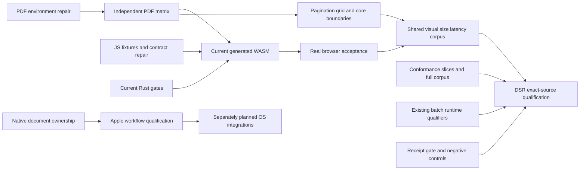

# Reality check and bridge plan — 2026-10-24

**Assessed source:** `ab170acf2748ffacefa71851427158bea6e3a542`, clean `main`
at intake. Probes began October 23 local time and continued October 24. This
assessment supersedes the June assessment preserved below and the current-use
conclusions of `docs/RELEASE_READINESS.md`; it does not erase historical evidence.

**Verdict:** the rendering foundation is substantial and the released CLI really
works. The project is **not finished or currently qualified against its whole
vision**. The principal gaps are a reproduced released-PDF correctness defect,
red current JavaScript/format gates, missing fresh Rust/WASM/device execution,
remaining conformance/typography coverage, and stale delivery/readiness claims.
Completing the six previously unfinished beads would not close those gaps.

This session assessed the product and completed the bridge-plan/Beads workflow.
It did not change renderer code, weaken a gate, regenerate a golden, close an
implementation bead, publish a package, alter an app submission, or use Actions.

## 1. Evidence boundary and documentation intake

Read the complete repository `AGENTS.md` (221 lines) and `README.md` (1,021
lines), the complete reality-check skill and its gap/bridge/ambition references,
and the comprehensive plan, prior bridge plan, both performance plans, SIMD
design, PDF TODO, changelog research, Apple app plan, testing/readiness docs,
WASM README/profiles, and relevant pagination, accessibility, font, batch and
publication contracts. June implementation descriptions are historical, not a
description of October code. Feature docs and source were cross-checked where
they disagreed; this is not a claim that every source line or every feature guide
was read or every possible input audited.

The literal `/data/projects/AGENTS.md` is unavailable on this Mac; a read-only
probe on the documented `fmd` server also found it absent. Read the complete
machine guidance at `/Users/jemanuel/projects/AGENTS.md` and the available
539-line `/Volumes/trj-data/projects/AGENTS.md`. That copy lacks the named
reward-hacking and work-graph sections cited by this repository. The repository's
explicit summaries were obeyed: no gate weakening, destructive recovery,
self-speedup claim, undocumented dependency, or forceful graph reconciliation.
No performance implementation was undertaken with that document unresolved.

Evidence classes are kept separate:

- **Current-source execution:** format check, JavaScript tests, dependency-tree
  query, release-version parity script and AST scans.
- **Current-source inspection:** real parser/HTML/PDF/font/layout/pagination,
  WASM adapters, batch, native ownership and test/gate wiring.
- **Released-artifact execution:** downloaded, SHA-256-verified Apple Silicon
  `v0.6.0`, rendered and decoded independently. This source is 104 commits
  behind assessed `main`, despite sharing version `0.6.0`.
- **Unrun/refused:** current Rust compile/test, current generated WASM and actual
  browser/native acceptance. Historical green receipts do not fill these cells.

Compact committed evidence is in
[`assessment.json`](../../tests/artifacts/reality-check/reality-20261023T2349/assessment.json),
[`node-failures.tsv`](../../tests/artifacts/reality-check/reality-20261023T2349/node-failures.tsv)
and the
[`released conformance ledger`](../../tests/artifacts/reality-check/reality-20261023T2349/released-conformance-ledger.tsv).
Raw run products remain locally under the same directory, with hashes in the
assessment receipt. Generated binaries, archives, PDFs and screenshots are not
added to the repository as source.

## 2. What was actually executed

| Probe | Result | What this establishes |
|---|---|---|
| `cargo fmt --check` | **FAIL**, 17 files | Current formatting gate is red; no formatting rewrite was made during this audit |
| Complete 231 `.test.mjs` files, Node 26.8.1 | **3,552 tests: 3,474 pass, 78 fail, 0 skipped/cancelled**, 22 failing files | Current JavaScript/oracle suite is red; failures are not automatically 78 independent production defects |
| `cargo tree --locked --no-default-features --edges normal --prefix none` | **PASS**, only root + `fmd-font` + `fmd-math` | Actual no-default normal dependency graph has zero third-party crates; this is metadata, not compilation |
| AST scans of production Rust roots | No `todo!` or `unimplemented!` matches | No obvious macro placeholders; not proof of complete behavior |
| `scripts/check-release-parity.sh` | **PASS** | Source manifests agree: root/WASM 0.6.0, font 0.3.4, math 0.2.0; not registry or artifact identity proof |
| Current workspace `cargo test --workspace --locked` | **REFUSED**, RCH exit 103 `queue_timeout` | No current Rust tests executed |
| Current `cargo check --all-targets --locked` | **REFUSED**, same | No compile pass claimed |
| Current `cargo clippy --all-targets --locked -- -D warnings` | **REFUSED**, same | No Clippy pass claimed |
| Current no-default wasm32 library build | **REFUSED**, same | No fresh portability build claimed |
| Verified released CLI: showcase HTML + PDF | **PASS**, HTML 98,980 bytes; PDF 62,818 bytes, 4 pages | Real released end-to-end rendering works for this fixture |
| Released showcase, repeated fixed epoch/options | **PASS**, byte-identical PDF | Same-binary/same-host determinism; not cross-OS proof |
| Released showcase, `qpdf --check` / `pdfinfo` | **PASS**, tagged PDF 1.7, no syntax/stream errors | Independent structural validation of this artifact; not PDF/A or PDF/UA certification |
| Released showcase first-page raster | Personally inspected; readable headings, styled text, links and nested lists | Bounded visual observation, not whole-corpus quality acceptance |
| Released official CommonMark harness | **589/652**, 589/606 in-scope; 46 policy exclusions, 17 known gaps | Reproduces the documented release floor; current-source conformance remains unrun |
| Released PDF under `FMD_TAIL_NOHEX=1` | **FAIL**, `qpdf` exit 3; text extraction shrinks from 51 bytes to one form-feed | Reproduced shipped defect; the same production switch remains in current source |

RCH attempts used the exact clean committed baseline and required remote
execution. Early unsupported RCH argument combinations are retained as setup
failures; the actual four lanes ended in queue refusal. No shim bypass or local
fallback was used. Available fleet slots did not establish command admission.

The initial JavaScript command selected 230 files and yielded 3,550/3,474/76.
Discovery found the nested font-oracle file; the complete rerun yielded the
3,552/3,474/78 result above. Neither result is described as green.

## 3. Vision checklist: promise to code, proof and remaining work

`PARTIAL` identifies actual remaining scope; `UNPROVEN` means current execution
is missing. The released example is working evidence only for its stated slice.
IDs below abbreviate the established full `br-best-in-class-markdown-renderer-`
`fmd-agent-ergonomics-commonma-` prefix; all new work is under `m80e`.

| # | Concrete promised goal and source | Reality / evidence | Status and coverage |
|---|---|---|---|
| V1 | First guessed file/stdin/raw-text commands; stdout/data, JSON and stable exits (README CLI; AGENTS CLI) | Real `cli.rs` dispatch and contract tests; released capabilities and file render execute | Current **UNPROVEN** beyond inspected/released slice; `.6`, `.8`, `.27` |
| V2 | Own parser/render/font/PDF code; no heavy production dependencies (AGENTS architecture) | First-party modules, dependency-tree proof and unsafe-forbid configuration | Boundary substantially delivered; compile **UNPROVEN**; `.6`, `.22`–`.23` |
| V3 | One AST and typed theme for HTML/PDF (README architecture) | `lib.rs` document APIs, `html::render`, PDF palette/layout share AST/theme; released both-output works | Implemented; broad theme-output proof **UNPROVEN**; `.7`, `.21` |
| V4 | CommonMark ladder, GFM and faithful source semantics (comprehensive plan §5.1) | Real block/inline parser; official release has 17 non-policy mismatches | **PARTIAL**; no prior unfinished conformance bead; `.11`–`.16` |
| V5 | Safe escaping, malformed-input bounds and no silent destructive fallbacks (plan §7) | Sanitizer, depth/work limits, fuzz/properties and byte-bounded shell exist; no fresh Rust execution | **UNPROVEN** current; `.6`, `.9`–`.10`, `.21`; batch safety existing `dqay`/`5s49` |
| V6 | Polished standalone HTML, CSS replacement, embedded fonts, responsive tables (README output) | Substantial emitter, WOFF1/2 and embedded assets; release produces standalone HTML | Implemented; current offline browser visual acceptance **UNPROVEN**; `.5`, `.7`, `.21` |
| V7 | Shared focused highlighting, deterministic fallback for unsupported languages (README code) | Real whole-block and resumable lexers, language routes and split-corpus tests | Implemented, not complete language parsers; current suites **UNPROVEN**; `.6`–`.7`, `.21` |
| V8 | Metrics, kerning, ligatures, curated subsets, selectable text (AGENTS typography) | `fmd-font`, shaping/subsetting and PDF positioning are real; release normal text extracts | **PARTIAL/DEFECT**: ambient production debug switches corrupt output; `.1`–`.2` |
| V9 | Knuth–Plass, Liang hyphenation and opt-in microtype (AGENTS typography) | Integer box/glue/penalty engine, language patterns, real PDF callsites and tests | Implemented focused scope; current quality/feature combinations **UNPROVEN**; `.6`, `.18`, `.21` |
| V10 | Leading and production baseline grid (AGENTS typography; plan §5.6) | `snap_blocks_to_baseline_grid` exists but no production PDF callsite was found | **PARTIAL**, previously **NO_BEAD**; `.19`–`.20` |
| V11 | Widows/orphans, keep-with-next and deterministic high-quality pages (AGENTS; plan §5.7) | Exact bounded line-grid/mixed-height planners plus integrated opt-in alternatives; default/fallback paths use soft penalties | **PARTIAL**, hard solver guarantees do not automatically describe every emitted PDF; `.17`–`.18` |
| V12 | Measured tables, repeat headers, sane breaks; styled lists/quotes/code/images (AGENTS typography) | Real constrained table allocation, repeated-header artifacts, inline images/math, financial-table extension | Implemented focused scope; broad visual/page proof **UNPROVEN**; `.18`, `.21` |
| V13 | Page-bottom footnotes and math without losing source (README) | Measured numbered notes, formulas, tags/ActualText; tall/unreferenced notes retain documented trailing fallback | Implemented bounded scope; no split-note/general-TeX claim; `.18`, `.21` |
| V14 | Tiny valid deterministic PDF with compressed streams (README; plan §5.8) | Real serializer/resources/subsets; independent release validation and repeat proof | Working released slice; current output **UNPROVEN**, environment defect confirmed; `.1`–`.2`, `.21`–`.23` |
| V15 | Useful tagged reading order and honest archival/accessibility status (README limitations) | Hierarchical multipage structure, table header IDs and links in source; focused structural tests | **PARTIAL**; fresh veraPDF/assistive checks unrun; full PDF/UA certification is an explicit non-goal; `.21`, `.9`–`.10` |
| V16 | Browser core without ambient files/network/fonts/threads (AGENTS WASM) | Hosts supply bytes; WASM cfg and feature boundaries exist; no-default dependency tree passes | Fresh build **UNPROVEN**; native core automatic compression threads contradict the stronger embeddability wording; `.7`, `.22`–`.23` |
| V17 | Generated WASM API, complete package and actual native parity (README WASM; plan §3.3) | Broad adapters, workers, profiles and build scripts; current generated profiles explicitly unverified in their docs | **UNPROVEN** current; wrappers/doubles are not generated runtime proof; `.7`, `.5` |
| V18 | Correct editor/worker ownership, recoverable source and coherent publications (maintained browser docs) | Extensive real orchestration with explicit boundary doubles; current 78 failures include fixture drift and disputed contracts | **PARTIAL/RED PROOF**, not established 78 product defects; `.3`–`.5` |
| V19 | Native batch, includes, cancellation, bounded workers and source protection (AGENTS Asupersync; batch contract) | Real optional Asupersync code; fixed job estimate and per-file cancellation are documented limits | **UNPROVEN** recent tranche; preserve existing `5s49`, `dqay`, `awfh`; `.27` depends on these |
| V20 | Fast ordinary HTML, small WASM/PDF, measured optimization discipline (plan §6) | Harnesses/ledgers exist; old timings do not qualify 104 newer commits | **UNPROVEN** current; `.21`, `.7`, `.23`; SIMD remains unapproved/unnecessary without evidence |
| V21 | Agent tools/book/site/EPUB/SVG/LSP reuse the rendering core (current README/feature docs) | Substantial modules and tests, not empty dispatch stubs; significant post-tag changes | Current integration **UNPROVEN**; `.6`–`.7`, `.21`, `.27` |
| V22 | Shipped artifacts, DSR-only delivery and truthful version claims (AGENTS releases; README install) | Live channels verified, manifests align, disabled Actions retained; frozen release clone differs from current source | **PARTIAL** channel/document drift and qualification; `.8`–`.10`, `.27`; existing `ihx0` stays blocked |
| V23 | Offline native document app with file ownership, save/restoration and accessible export (Apple plan §§4–10) | WindowGroup/custom session, coordinated saves, recents, recovery and scene actions exist; full browser/autosave promise remains open | **PARTIAL/UNPROVEN**; existing `4rvj`, `voz6`; `.24`–`.25` |
| V24 | Share extension, widgets, Shortcuts, metadata-only Spotlight and Handoff (Apple plan §8) | No implementing system-integration types found in inspected Swift tree | **NOT_STARTED** source finding / previously **NO_BEAD**; `.26` and six children; P3, separate from CLI release critical path |

## 4. The gaps that matter most

### G1 — production environment can invalidate a shipped PDF (P1 correctness)

`src/pdf.rs:64`–`71` latches `FMD_TAIL_NOPAIR`, `FMD_TAIL_NOHEX` and
`FMD_TAIL_NOGLYPH` outside test-only code. Around lines 33,032–33,175 those
switches can suppress kerning, force glyph zero or write malformed nested hex.
The same switches occur in tag `v0.6.0`. With fixed source/fonts/options/epoch,
`FMD_TAIL_NOHEX=1` gives qpdf stream syntax warnings and removes extracted text.
This is executable defect evidence, not speculation about a future risk.

**Bridge:** `.1` restores unconditional production semantics; `.2` spawns fresh
processes for every variable/combination and independently decodes syntax,
glyph placement and logical text. Audit related timing instrumentation without
discarding supported profiling APIs. Expected complexity S–M; highest immediate
return. Do not change goldens or public options to accommodate corruption.

### G2 — current JavaScript acceptance is red (P1 integration/proof)

The 78 failures span 22 files. Fifty arise in three repeated missing-control
fixture families (27 + 13 + 10); others include stale ESM import closure,
source-shape regex/count assumptions, evolving project schemas, viewport/delta
wire expectations and optional asynchronous semantic-reading behavior. Two
font-oracle failures follow a regex that sees only 14 of 25 formatted Rust data
rows; they do not establish broken Unicode normalization. Conversely, a stale
fixture explanation is not permission to dismiss a failed ownership test.

**Bridge:** `.3` repairs complete fixtures/oracle extraction while preserving
their invariants; `.4` adjudicates production-vs-old-contract behavior using
actual negotiated transport; `.5` verifies real DOM/generated-WASM races and
downloads. Expected complexity M–L. A legitimate oracle correction must retain
negative controls and publish what the corrected gate admits and rejects.

### G3 — no fresh current Rust/WASM qualification (P1 proof blocker)

Formatting fails in 17 current files. All four compilation/test lanes were
refused by RCH with terminal exit 103. This does not prove Rust source broken,
and it does not prove it builds. Browser JavaScript passing subsets cannot stand
in for Rust, generated bindings, current font/math golden results or actual
native/WASM parity. Required mcp/lsp/batch/optional WASM features need their own
configuration coverage.

**Bridge:** `.6` restores formatting and runs pinned-toolchain gates on admitted
capacity; `.7` generates source-fenced profiles/packages, checks real exports,
resource closure, declaration types, equivalent-feature parity and unchanged
7,900,000 raw / 3,400,000 gzip full-package ceilings. Expected complexity M for
qualification, with failure-specific fixes scoped after evidence. No bypass.

### G4 — a ratcheted parser floor is not complete CommonMark (P2 implementation)

The reproduced release gaps are:

| Slice | Official example IDs | Implementation / companion proof |
|---|---|---|
| Links, references and autolinks | 201, 491, 494, 524, 536, 611, 612 | `.11` / `.12` |
| Escape, entity, code and emphasis | 21, 31, 344, 475, 476, 477 | `.13` / `.14` |
| Lists and hard breaks | 308, 309, 642, 643 | `.15` / `.16` |

**Bridge:** first reproduce on current source, distinguish parse errors from
serialization differences, then repair exact official examples plus adversarial
neighbors and shared-AST behavior. Preserve all previous passing cases; a net
count increase alone must not hide new regressions. Retain sanitizing policy for
46 intentional mismatches. The full in-scope target is 606/606, not arbitrary
raw-HTML pass-through. Expected complexity M across three independent slices.

### G5 — typography machinery exceeds its universal production guarantee (P2)

Knuth–Plass, microtype and exact pagination exist. They do not imply that every
body paragraph gets every algorithm, every fallback respects hard rules, or
every supported option combination achieves a globally optimal document.
`exact_height_page_breaks_reserving` erases errors into `Option`; the PDF wrapper
can fall back to legacy guaranteed-progress planning. The default page-break
penalties are soft. Candidate/work limits and unsupported combinations are real
and sensible, but optimality/fallback provenance should be observable. Some
current note/quote admissions also exceed the older guide's stated exclusions.

The promised baseline grid is a distinct gap: the helper exists and has a unit
test, but no production PDF callsite was found. Drop caps and optical-kerning
helpers are not automatically mandatory product work merely because they exist.

**Bridge:** `.17`/`.18` expose quality fallback and verify emitted page/text/tag
constraints against independent small exhaustive cases; `.19`/`.20` integrate
opt-in fixed-point baseline-grid policy through real page layout and independently
measure text matrices. Preserve default bytes and bounded graceful progress.
Expected complexity M–L; no general TeX clone or complex-script promise.

### G6 — appearance, resource bounds and performance need current independent proof (P1)

Structural tags, render-tree goldens and hashes catch useful regressions; they
cannot by themselves establish visually excellent output, good selection or
assistive reading. A four-page release example is not whole-corpus acceptance.
Historical June coverage/performance numbers refer to a far smaller source tree.
`check-determinism.sh` repeats one host's render; it does not test multiple OSes.

**Bridge:** `.21` runs a bounded shared technical-document corpus through actual
HTML/browser/native/WASM paths, offline fonts/assets, all-page inspection,
independent qpdf/veraPDF where relevant, extraction, size breakdowns, typography
metrics and declared-machine cold/warm latency/RSS. Formal PDF/UA certification
and arbitrary SVG/CSS remain explicit non-goals. Validate the original ordinary
README HTML latency target without claiming an optimization win; any speedup
claim requires incumbent and candidate live in the same invocation. Complexity M.

### G7 — pure-core contract and automatic native threading diverge (P2 design)

Native `pdf.rs` has automatic thread pools for content compression, including in
no-default builds above size thresholds. WASM has a sequential cfg path, so this
is not evidence of a broken WASM target. It does contradict the stronger
thread-free embeddability wording and can multiply concurrency inside batch.

**Bridge:** `.22`/`.23` make compression scheduling explicit/shell-owned while
keeping shared sequential primitives, byte parity, bounded memory and graceful
spawn failure. Re-measure throughput rather than assuming either design wins.
Complexity M. Existing chunked emission and all public formats must survive.

### G8 — proof existence, current readiness and delivery are different (P1)

The claim registry checks capability strings and file existence, not fresh
successful execution. The WASM e2e wrapper can succeed after missing-tool skips.
`test-all.sh` does not directly qualify the complete evolving JavaScript/profile
surface. Some scripts rebuild through explicit local cargo bypasses. PDF/UA
spot-check informational results must not become archival/accessibility claims.

Live API checks establish GitHub `v0.6.0` (October 14, five platform archives),
crates `0.6.0`, npm **`0.5.0`**, and an attached **`0.6.0` npm tarball**. The
installed local binary is `0.4.5`. Current publishing credentials were not
tested: the old `ihx0` E401 story is historical, not a fresh external blocker.
The DSR release configuration deliberately names a frozen `-relwave` clone;
that release source cannot attest today's `main`. It also contains a borrowed
client User-Agent that must be corrected before that configuration makes requests.
It was not used for this audit's honestly identified API requests.

**Bridge:** `.8` repairs maintained claim/version/tooling documentation; `.9`/`.10`
aggregate executed source/artifact-bound receipts with stale/missing/failing
negative controls; `.27` inventories actual per-target source and smoke proof
through DSR. Preserve disabled Actions. No publication is authorized by this
assessment. Complexity S–M. Updating prose is maintenance, not repaired rendering.

### G9 — preserve the existing batch and Apple unfinished work

| Existing bead | Honest current state | Treatment |
|---|---|---|
| `5s49` | Includes implemented; 12 runtime regressions previously not completed | Keep open; qualify on admitted batch-capable host |
| `dqay` | Whole-plan source protection implemented; batch runtime proof incomplete | Keep open; byte-preservation acceptance remains required |
| `awfh` | Geometry implementation/native checks recorded; batch qualification incomplete | Keep open; no duplication or source-only closure |
| `4rvj` | Scene/request ownership fix and controlled-continuation tests exist; native execution pending | Preserve author ownership and qualify actual Catalyst/device artifact |
| `voz6` | Original icon restored/committed; release qualification/submission not established | Preserve exact icon and owner boundary; no submission change |
| `ihx0` | Font mechanics implemented and prior tests recorded; publication blocked historically | Add current channel evidence; do not rebuild fonts to disguise publication state |

`.27` explicitly depends on the three batch proof items. Apple `.24`/`.25`
complete promised document-browser/autosave/restoration behavior and actual
offline/accessibility/device acceptance while preserving current custom-session
capabilities. They do not claim the existing app is an empty shell.

The separate P3 `.26` subtree preserves planned Share extension, widgets, App
Intents, opt-in metadata-only Spotlight and Handoff, with one implementation
bead per integration and shared real-OS companion acceptance. These are app
vision gaps, not reasons to delay fixing the CLI PDF defect or to expand the
pure renderer into a generic platform. Every future Simulator action requires
the permanent audio-safety preparation/mute/BlackHole proof. No Simulator was
used in this assessment. Native scope is L; system integrations are separate
M-sized product slices, with device/provider availability explicit.

## 5. Bridge graph, ambition and refinement

**Root:** `m80e`. Created 34 issues: two epics and 32 scoped implementation,
documentation or proof tasks, with 45 new blocking edges plus parent relations.
Every implementation slice has a named companion proof task; each bead embeds
its source evidence, user consequence, implementation scope, acceptance and
non-claims, so it is usable without this document. Existing six unfinished
issues remain open/in-progress/blocked; **zero beads closed this assessment**.

Execution order follows user value:

1. `.1` → `.2`: stop released-PDF corruption and independently prove the repair.
2. `.3` and `.4`, plus `.6`: restore the actual current acceptance surfaces.
3. `.7` → `.5`: execute generated native/WASM/browser paths, including races.
4. `.9` → `.10`, `.8`: honest current proof aggregation and user documentation.
5. `.11`–`.20`, `.22`–`.23`: parser and typography/core gaps, each with companion
   evidence and exact constraints; shared final corpus `.21` then `.27`.
6. Existing batch qualifiers feed `.27`; native document `.24` → `.25` and P3
   system integrations progress on their own appropriate platform lane.

Three ambition passes improved the same plan: (1) graduate from a collection of
unit tests to one actual Markdown-to-output workflow, (2) tie appearance,
semantics, bounds and delivery to the same captured source/resources, and (3)
make optimizer constraints/fallback evidence precise rather than adding exotic
algorithms or treating self-speedup as a product win.

Five refinement passes checked: (1) goal coverage and duplication against all
460 original rows; (2) companions, independent oracles, negative controls and
complete discovery; (3) actual blocking directions/cycles and tool schema
compatibility; (4) historical-vs-current-vs-release proof and optional Apple
scope; (5) self-contained acceptance, source-safe tracking, complete graph and
unrun-gate review. Corrections include the extra oracle file, the exact 17
CommonMark IDs, browser contract-vs-fixture separation, and `task` plus `docs`
label for the new documentation bead because installed `bv` drops `docs` types.
The final review introduced no further scope change; implementation acceptance
remains open.

## 6. Tracker reconciliation and validation

Initial JSONL held **460 rows: 454 closed, five in-progress, one blocked**.
An explicitly read-only database view had only 444. Normal engine import added
16 missing rows. Reviewed reconciliation identified exactly one remaining
relation difference: database comment 168 on `voz6` was missing from JSONL.
It records the already-pushed original-icon restoration. Normal unforced engine
export preserved all 460 IDs, descriptions, statuses, labels and dependencies,
retained that additional comment, and removed machine-local `source_repo_path`
fields in the canonical portable export. No database/WAL deletion, reset,
replacement, force import or hand-written JSONL mutation was used.

After planning: **494 rows, 454 closed, 34 open, five in-progress, one blocked**.
`br` is authoritative; reviewed reconciliation reports no remaining conflicts.
`br dep cycles` is empty; `bv --robot-triage`, `--robot-plan` and
`--robot-insights` were run. The installed `bv` omits two historical closed
`docs` records, so its graph denominator differs from `br`; those records were
preserved. Some `bv` recommendations explicitly list unresolved prerequisites:
use `br ready` for actual eligibility. The graph is a plan, not evidence that
any product gap has been closed.

Report/evidence verification: `git diff --check` passed; independent inspection
of the canonical graph found all 34 new rows have acceptance criteria and no
cycles, including archived nodes. UBS was invoked on the changed Markdown and
ignore file and exited 3 because neither is a supported scanner language;
**nothing was scanned and no UBS pass is claimed**. No substantive Rust source
changed in this assessment.

## 7. Decision and remaining finish line

Do not restart this renderer or replace it with a dependency forest. It has a
working foundation, real typography and useful shipped output. Prioritize the
reproduced PDF defect, restore current executable acceptance and finish the
bounded quality/conformance contract before adding more surface area.

The original six unfinished issues alone cannot finish this: none covers the
ambient PDF switches, current 78-failure JavaScript/oracle acceptance, all 17
remaining spec examples, production baseline grid, observable pagination
fallback, or current cross-surface proof/delivery coherence. The new bridge
supplies that coverage. Completing the new graph is still not automatic
certification: current-source Rust/generated-WASM/browser/batch/visual/device
and relevant independent-validator gates must actually run and satisfy their
stated scope. No percentage of closed beads substitutes for those observations.

---

# Archived 2026-06-28 reality-check bridge plan

Date: 2026-06-28
Status: active — second full reality check (first was 2026-06-27, which produced beads `mwm.1`–`mwm.5`)
Scope: close every gap between the implemented code and the README/AGENTS/plan vision.

> This document is the iterate-in-place plan for the 2026-06-28 reality check. It
> is revised in-place across ambition rounds; it is NOT re-created per round.
> Beads remain the source of truth — every gap below maps to an existing bead or
> a new bead created from this plan.

## 0. Verified ground truth (2026-06-28)

The core engine genuinely delivers. Verified by running the software, not by
trusting tests:

- `cargo test`: 266 pass / 0 fail across 24 suites.
- Gate scripts green: `check-policy.sh`, `check-determinism.sh`,
  `check-wasm-core.sh`, `parser-diff.sh`.
- HTML render: 146 KB self-contained, inlined CSS, real subsetted `@font-face`.
- PDF render: 56 KB valid `%PDF-1.7`, byte-identical across runs; structural
  inspection confirms **5 embedded `FontFile2` TrueType subsets**,
  `Type0`/`CIDFontType2`/`Identity-H`, `ToUnicode`, `/W` arrays, link
  annotations.
- Clean-room boundary holds: zero third-party deps in the `--no-default-features`
  core; `unsafe_code = "forbid"`.

The bead graph is already comprehensive: 95/127 closed, 0 in-progress, 32 open,
and the open beads already cover WASM packaging, conformance, perf/SIMD, batch,
release, and the visual gauntlet. **This plan is therefore surgical**: it fills
the few genuine NO_BEAD holes and hardens weak acceptance criteria, rather than
duplicating tracked work.

## 1. Gap register (gap → status → owning bead)

| # | Gap | Reality-check finding | Owning bead | Action |
|---|-----|----------------------|-------------|--------|
| G1 | WASM browser package is a non-functional skeleton | No built `.wasm`; `wasm/franken_markdown.js` imports a missing `./pkg/`; demo can't load; `wasm_package_test.rs` Group A string-matches source | `3i5` (+ closed `3i5.2`/`3i5.4` on skeleton), open `3i5.5` | NEW build-artifact CI gate bead; HARDEN `3i5.5` acceptance |
| G2 | Full CommonMark/GFM conformance is unmeasured (~75–80% est.) | Only hand-written fixtures; no official spec suite; 12/250+ named entities; HTML blocks partial | `mwm.3` (strong) | REFINE: numeric target + surface measured % in capabilities/README |
| G3 | Deep pagination partial | Soft widow/orphan + heading/table-header keep only; no keep-with-next/footnotes/columns | closed `49d.1`; README honest | NEW follow-up bead for keep-with-next + footnote design (was punted) |
| G4 | SIMD acceleration not implemented | Design docs only; zero SIMD code (correctly gated on profiling) | `qw1.5.*` | No change — gate is correct |
| G5 | Asupersync batch mode absent | Not in `Cargo.toml`; no batch command | `zmd`, `zmd.1.*` | No change — full sub-tree exists |
| G6 | "One theme model" violated: PDF hardcodes colors | `zod` closed but explicitly "Avoided pdf lane"; `src/pdf.rs:48-68` hardcodes link/code/quote/table RGB; no dark mode in PDF | **NONE (NO_BEAD)** | NEW bead + companion test bead |
| G7 | No release/installer | No published artifacts | `08f` | No change |
| G8 | Visual/raster goldens early | Structural + determinism only; no raster comparison | `qw1`, `qw1.1` | REFINE: require deterministic raster/render-tree goldens |
| G9 | `--to pdf` w/o `--out` writes `document.pdf` | Contradicts README troubleshooting ("requires --out"); created stray repo-root files | partial `mwm.2` (dash handling, closed) | NEW tiny bead: reconcile default-output behavior vs docs |
| G10 | "first-class WASM" claim outruns artifacts | README/marketing assert shipped WASM; package is skeleton | `mwm.5` release gate | REFINE `mwm.5` + NEW `N5` claim-discipline CI gate; block on G1/N2 |

## 2. New beads to create (genuine NO_BEAD gaps)

### N1 — PDF: consume shared theme colors (unify the one-theme-model doctrine)
- **Why:** AGENTS.md doctrine: "HTML and PDF must share one parsed AST and one
  theme model so visual output stays coherent." `zod` built the theme tokens and
  wired HTML, but explicitly punted the PDF lane; PDF still hardcodes
  `LINK_COLOR`, `PANEL_GRAY`, quote/table colors in `src/pdf.rs:48-68`.
- **Scope:** Route PDF link/code-chip/blockquote/table-rule/heading-rule/zebra
  colors through `Theme`/`ThemeColors`. Decide and document PDF dark-mode policy
  (either honor `dark_mode` for PDF, or record it as an intentional light-only
  non-goal with rationale).
- **Acceptance:** PDF colors derive from theme tokens; changing a theme token
  changes both HTML and PDF; determinism + size budgets unchanged.
- **Tests (companion bead N1-T):** structural test asserts PDF color operators
  match theme tokens for a known theme; a second theme yields different,
  still-deterministic bytes.

### N2 — WASM: real built-artifact CI gate + headless execution proof
- **Why:** "first-class WASM" requires a *runnable* artifact. Today the JS
  package and demo were closed on a hand-written skeleton; `check-wasm-package.sh`
  exists but is NOT in CI; no test loads a real module in a browser/wasm runtime.
- **Scope:** Wire `scripts/check-wasm-package.sh` (build `wasm-bindgen` → emit
  `pkg/` → assemble) into CI; add a headless smoke test (node/`wasm-pack`-style
  runner or a wasm32 test harness) that imports the *generated* module and calls
  `renderHtml`/`renderPdf`/`capabilities`, asserting real output bytes.
- **Acceptance:** CI fails if the package can't build or the headless smoke test
  can't render; the emitted `.wasm` size is measured against a budget.
- **Explicit anti-pattern:** string-match-only tests over source files
  (`wasm_package_test.rs` Group A) MUST NOT count as proof of "first-class WASM";
  they are demoted to "source-shape lint."
- **Tests (companion bead N2-T):** headless render of a fixture Markdown to HTML
  and PDF, byte-compared (or structure-compared) to the native render of the same
  input + options.

### N3 — PDF: keep-with-next + footnote pagination design (deep-pagination tail)
- **Why:** `49d.1` landed the vertical page builder with soft penalties; the
  vision lists keep-with-next and footnote handling, which were punted.
- **Scope:** Design (and, if cheap, implement) explicit keep-with-next block
  association and footnote placement, with deterministic fallback. Mark column
  layout as an explicit non-goal unless demanded.
- **Acceptance:** fixtures where a heading never strands from its following block;
  footnote markers resolve deterministically; no regression in existing goldens.

### N4 — CLI/docs: reconcile `--to pdf` default-output behavior
- **Why:** Running `fmd --to pdf --text '# x'` (no `--out`) silently writes
  `document.pdf`; README troubleshooting says PDF "requires `--out <path>`".
- **Scope:** Either (a) make the default-output behavior explicit and documented
  (preferred: keep convenience, document it, emit the path on stderr — already
  does), or (b) require `--out` for PDF and error with exit 64. Pick one; align
  README, capabilities JSON, and `cli_contract.rs`.
- **Acceptance:** docs, capabilities, and behavior agree; a contract test pins it.

## 3. Refinements to existing beads (harden acceptance)

- **`3i5.5`** — add: proof MUST execute a generated wasm-bindgen module (not the
  native adapter, not string matching); size budget measures the real `.wasm`;
  reference G1/N2 as the build dependency.
- **`mwm.3`** — add: harness must emit a single measured conformance percentage,
  surfaced in `capabilities --json` and README, replacing the prose "useful
  subset"; every failing official example gets a gap-ledger row + owning bead.
- **`mwm.5`** — add: 2026-06-28 reality-check note; add N1/N2/N3/N4 as additional
  blockers; add a claim-discipline check (no README capability claim ships unless
  a runnable proof command exists), and explicitly block "first-class WASM"
  marketing on N2 being green.
- **`qw1` / `qw1.1`** — add: visual gauntlet must include a deterministic
  raster-or-render-tree golden (not only structural + byte determinism), so PDF
  *appearance* regressions are caught.

## 3b. Ambition layer — certified, ratcheted, drift-proof proofs

The incremental fixes above remove today's gaps; this layer makes the gaps
*unable to reopen*. Each upgrade turns a one-time fix into a standing invariant
enforced in CI, using techniques the "pull in comrak + a PDF crate" crowd would
never bother with — which is exactly the moat.

### N1 → theme as a single source of truth with derived projections
Treat `Theme` as a normalized store and HTML/PDF/CLI-JSON/WASM as *projections*.
- Add a **theme-token coverage ledger**: enumerate every visual token (link,
  code-chip bg/fg, quote bar/tint, table rule/zebra, heading rule, dark variants)
  and assert each is consumed by *both* the HTML CSS generator and the PDF color
  emitter. CI fails if a token exists with only one consumer (catches future
  divergence at the source, not in review).
- **Cross-surface invariant test:** for a fixed theme, the link color in the HTML
  `<style>`, the PDF link-annotation/border color operator, and the
  `capabilities --json` theme token all decode to the same RGB. One projection
  can never silently drift from another again.

### N2 → certified native↔WASM differential parity ("same core" with evidence)
The README claims HTML/PDF come from "the same dependency-free render core." Make
that a *proof*, not a promise, via a certified-rewrite framing:
- **Native render = specification; WASM render = implementation under test.**
- Build a small corpus (the showcase + edge fixtures). For each input+options,
  render natively and via the *generated* wasm module in a headless runtime;
  assert byte-identical HTML and byte-identical PDF (determinism already holds, so
  parity is the real test). Retain any counterexample as a fixture.
- **Size budget with teeth:** measure raw + gzip + brotli of the emitted `.wasm`;
  CI ratchets (a size increase beyond a committed delta fails until the budget is
  consciously bumped).

### mwm.3 → a ratcheted conformance ladder, not a one-time number
- Commit `conformance_target = N%` and a measured `conformance_actual`. CI **fails
  if actual drops below the committed floor** (a ratchet), so conformance can only
  go up. Raise the floor as gaps close.
- Layer three test modalities so coverage is adversarial, not anecdotal:
  official-spec **differential** (reference outputs vendored as *dev-only test
  data*, never a production dep), **metamorphic** (already present — extend:
  e.g. `wrap-in-blockquote(parse(x)) ≡ parse(wrap-in-blockquote(x))` for safe
  constructs), and **property/fuzz** (no panic; output is well-formed; round-trip
  invariants).
- Distinguish four states per example: `pass`, `known_gap` (owning bead),
  `intentional_non_goal` (rationale), `needs_design`. The README percentage is
  computed from this ledger, never hand-edited.

## 3c. New standing gate — claim discipline (mechanical, not vibes)

### N5 — README ↔ capabilities claim-discipline CI gate
- **Why:** the only place marketing outran reality this cycle was "first-class
  WASM." Make overclaiming *mechanically impossible* to ship.
- **Scope:** a script that extracts capability claims from README/CHANGELOG
  (a curated, labeled claim list) and cross-checks each against
  `capabilities --json` feature flags + a proof-command registry. A claim flagged
  `available` with no green proof command fails CI.
- **Acceptance:** flipping a feature to "available" in README without a passing
  proof command turns CI red. "first-class WASM" stays gated on N2 going green.
- **This is the structural antidote** to the bead-completion / doc-overclaim
  illusion this very reality check exists to catch — encoded so the *next* reality
  check finds nothing to flag here.

### Domain-depth note (for the optimizer/perf beads, not new scope)
The perf sub-tree (`qw1.5.*`, `qw1.7.*`) already cites the right tools: the
Knuth-Plass DP, prefix-sum segment metrics, and a committed double-array/compact
hyphen trie. The standing requirement when those land: any "shortcut"
optimization (Monge/SMAWK line-break, active-list dominance pruning) must **emit a
runtime certificate** proving its precondition for that input and fall back to
exact DP when the certificate fails — never an unproven asymptotic shortcut. This
is already encoded in `PERFORMANCE_OPTIMIZATION_PLAN.md`; the beads must keep that
proof obligation in their acceptance criteria.

## 4. Sequencing

1. N1 (theme colors) + N1-T — small, high-coherence, no external tooling.
2. N4 (doc reconciliation) — trivial, removes a live doc/behavior contradiction.
3. mwm.3 refinement → run the conformance harness → record the real %.
4. N2 (+N2-T) WASM artifact CI gate → unblocks honest "first-class WASM."
5. N5 claim-discipline gate — cheap, and it permanently prevents the overclaim
   this reality check just caught.
6. N3 pagination design; qw1/qw1.1 raster goldens.
7. mwm.5 release gate re-run once N1–N5 + 3i5.5 are green.

## 5. Proof obligations (every bead closeout)

`cargo fmt --check` · `cargo check --all-targets` ·
`cargo clippy --all-targets -- -D warnings` · `cargo test` ·
`scripts/check-policy.sh` · `scripts/check-wasm-core.sh` ·
`scripts/check-determinism.sh` · `scripts/parser-diff.sh`, plus the bead-specific
gate (raster golden, headless WASM smoke, conformance ledger, etc.). No claim in
README/capabilities without a runnable proof command.
