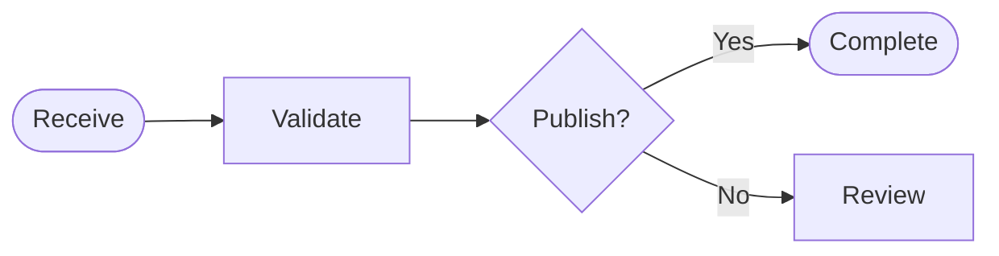
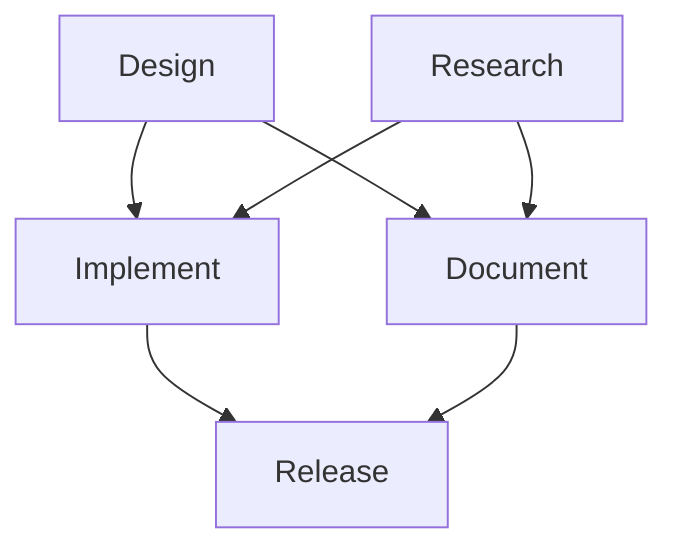
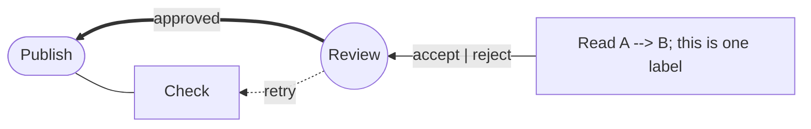
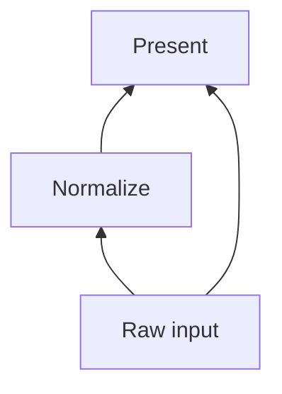

# Native flowcharts

The same first-party diagram compiler serves HTML, PDF, SVG, and EPUB output.

## A chain with a decision

## Several dependencies on one line

## Quoted text and a right-to-left direction

## Bottom-to-top dependencies

