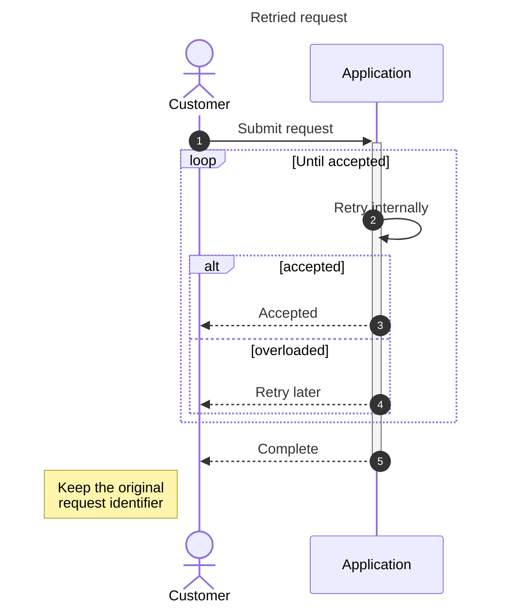
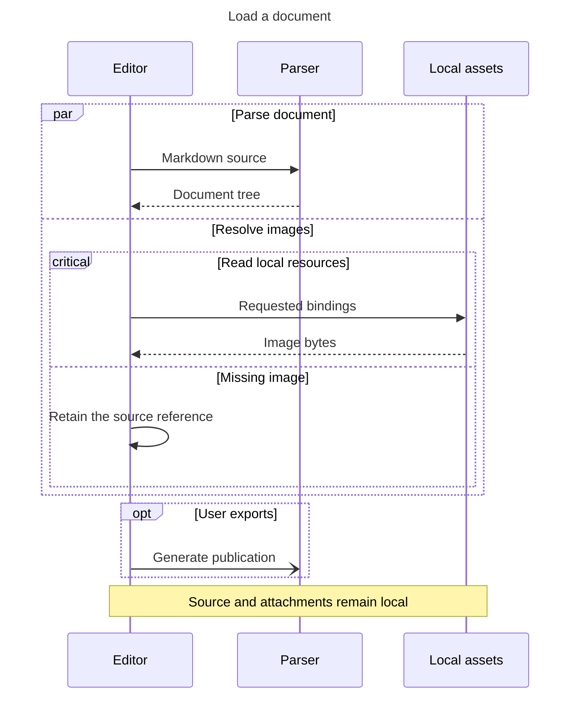

# Sequence diagrams with complete interaction semantics

The same bounded first-party compiler produces native vector figures in HTML,
PDF, SVG posters, and EPUB. These examples require no Mermaid.js or network.

## Requests, retries, and alternatives

## Parallel work and conditional recovery

