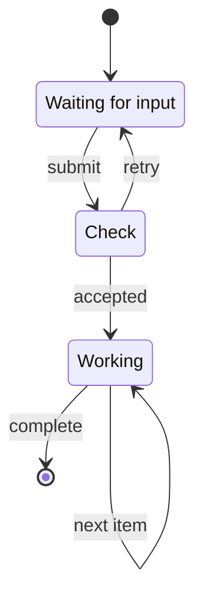
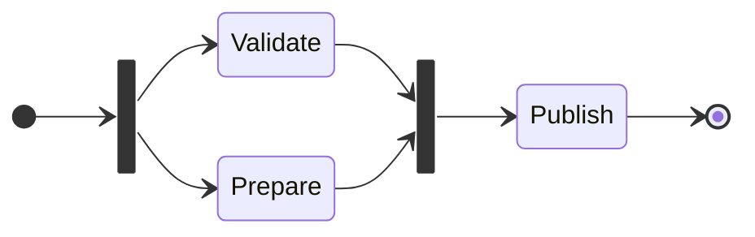
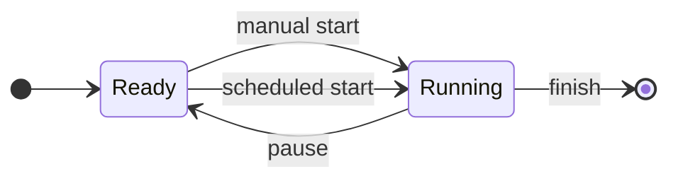

# Native state machines

These diagrams render through the same first-party compiler in HTML, PDF, SVG,
EPUB and browser Flow.

## A request lifecycle

## Parallel work and a join

## Different events between the same states

